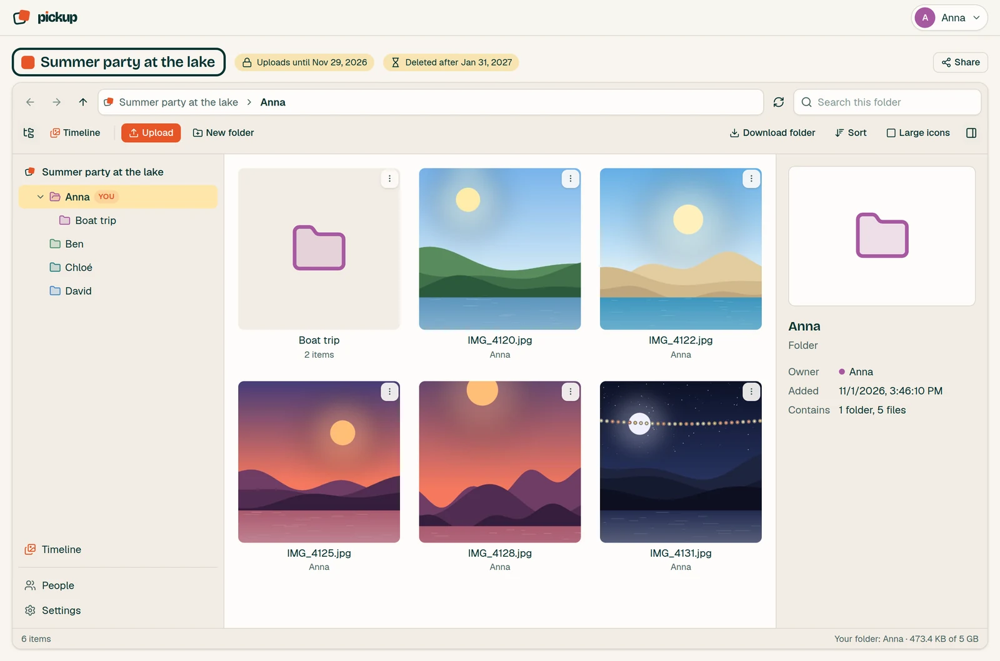
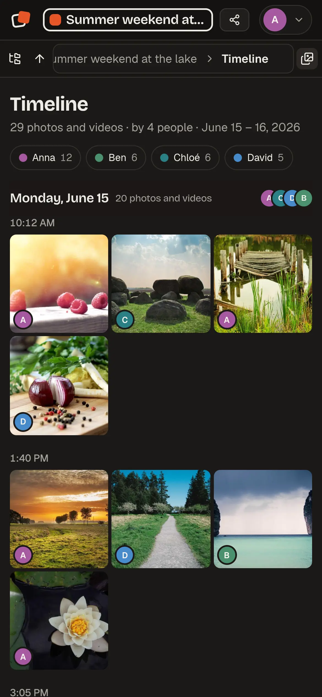

# Pickup

After a party, a wedding or a holiday, everyone has photos on their phone and nobody has all of them. Pickup is a small self-hosted app to collect them: you create a pickup, send one link around, and everyone uploads into a folder of their own. Nobody needs an account.

<p align="center">
  
  &nbsp;
  
</p>

## What it does

- Everyone who joins gets their own folder (with subfolders if they like). Only they can change it; everyone else can look and download.
- The pickup page works like a file manager: folder tree, address bar, several views, sorting, search, right-click menus and keyboard shortcuts. On a phone it has its own layout, and a tap opens a folder or photo.
- The timeline shows all photos and videos of all folders in the order they were taken, grouped by day and moment, with a filter per person.
- Photos and videos keep their full quality. The server makes small previews, a lighter copy for viewing large photos and stills of videos; iPhone photos (HEIC) work in every browser. Large files are uploaded in chunks, so multi-GB videos are fine, and the same file twice is skipped.
- Everything, a folder or a selection can be downloaded as one ZIP.
- Instead of an account, each participant has a personal link. It can be mailed to them, and the creator can pass it on if someone loses it.
- The creator decides who may look and who may join, can invite people by email, set a password, remove people or files, make the pickup read-only from a certain day and have it deleted on another.
- English and German, following the browser.

## Running it

Pickup runs as one container next to Postgres. You need Docker with Compose.

```bash
cp .env.example .env    # set SECRET_KEY, EMAIL_HASH_KEY, DB_PASSWORD, ADMIN_PASSWORD, APP_URLS
docker compose up -d --build
```

The app is then at http://localhost:8080 (`APP_PORT`). Compose starts three services:

- `db`: PostgreSQL 18, data in the `db-data` volume.
- `app`: nginx, gunicorn and a job worker under supervisord. nginx serves the app and hands out uploaded files only after Django has checked access; the worker sends mails (and retries them), deletes expired pickups and catches up on previews. Migrations run on every start. The container's root filesystem is read-only, it has no capabilities and runs as an unprivileged user; only `/data` (volume `app-data`) and `/tmp` are writable.
- `backup`: a nightly backup, see below.

Every setting is described in `.env.example`. The ones you will most likely touch:

- `APP_URLS` and `TRUSTED_PROXIES`: behind a TLS reverse proxy, set `APP_URLS=https://your.domain` and `TRUSTED_PROXIES` to the proxy's address. Django then uses secure cookies and redirects to HTTPS. HSTS is up to the proxy.
- `EMAIL_HOST` and friends: without a mail server Pickup works, but personal links can't be mailed.
- `PICKUP_STORAGE_LIMIT`, `MEMBER_STORAGE_LIMIT`: how much a pickup and one participant may upload (`0` is unlimited).
- `PICKUP_CREATION`: `everyone` may create pickups, only people with one of the `PICKUP_CREATION_CODES` (`code`), or nobody (`none`).
- `SERVER_NAME`: how the iOS and Android apps list this server (empty: its host name).
- `ADMIN_ENABLED`: the Django admin at `/admin` is closed unless this is `true`.

Uploads: nginx accepts request bodies up to 25 MB; the app sends larger files in 5 MB chunks. Assembling a chunked upload copies the file once, so `GUNICORN_TIMEOUT` (default 300 s) has to cover the largest file on your disk.

### Backups

The `backup` service writes into the `backups` volume every night at `BACKUP_TIME` and keeps `BACKUP_KEEP_DAYS` days of:

- `db/pickup-<time>.dump`, a PostgreSQL dump (custom format), and
- `media/<time>/`, a snapshot of all uploaded files. Files never change once uploaded, so unchanged ones are hard links to the previous snapshot: every snapshot is complete, but only new files take space.

Run one right away with `docker compose exec backup sh /backup.sh now`. A backup on the same disk doesn't help when the disk dies, so copy them somewhere else:

```bash
docker compose cp backup:/var/lib/postgresql/backups ./backups
```

(`docker compose cp` turns the hard links into copies. For a lot of media, point your host's backup at the `pickup_backups` volume instead, for example with `rsync -aH`.)

To restore, stop the app first (`docker compose stop app`), then:

```bash
# the database
docker compose exec -T backup sh -c 'pg_restore --clean --if-exists -d "$PGDATABASE"' < backups/db/pickup-<time>.dump

# the files, from a snapshot in the backups volume
docker compose run --rm --no-deps --user 10001:10001 --entrypoint sh \
  -v pickup_app-data:/restore backup -c \
  'mkdir -p /restore/media && cp -R /var/lib/postgresql/backups/media/<time>/. /restore/media/'

docker compose start app
```

### Admin commands

```bash
# storage of one pickup: show it, or change its limits (sizes like 50GB, "unlimited", "default")
docker compose exec app python manage.py storage_limits <pickup id>
docker compose exec app python manage.py storage_limits <pickup id> --pickup 50GB --member unlimited

# a creator forgot their pickup's password: remove it, they set a new one
docker compose exec app python manage.py pickup_password <pickup id> --remove

# the link that adds this server to the apps' server list (/connect); with PICKUP_CREATION=code
# it carries the first code (or --code …, or --no-code), so share it only with people who may create
docker compose exec app python manage.py server_link

# the admin user's password
docker compose exec app python manage.py set_password admin
```

## Development

You need [uv](https://docs.astral.sh/uv/) (it brings Python 3.14), Node.js 24 with pnpm, and optionally Docker for Postgres.

```bash
cp .env.example .env
cd backend && uv sync && uv run python manage.py migrate && uv run python manage.py ensure_admin
cd ../frontend && pnpm install
```

The VS Code tasks in `.vscode/tasks.json` hold the everyday commands; **dev** starts Django on :8000 and Vite on :5173. Without VS Code:

| What | Command |
|---|---|
| Backend | `cd backend && uv run python manage.py runserver` |
| Frontend | `cd frontend && pnpm dev`, then open http://localhost:5173 |
| Everything CI checks | task **check** |
| Backend tests | `cd backend && uv run pytest` |
| Frontend checks | `cd frontend && pnpm check` |
| After model changes | `uv run python manage.py makemigrations` |
| After API changes | task **api: types** (regenerates `frontend/openapi.json` and `src/api/schema.d.ts`) |
| After changing server texts | task **django: messages**, then translate the new entries in `backend/locale/de` |
| Postgres instead of SQLite | task **db: start dev postgres**, then `DB_TYPE=postgres` and `DB_HOST=localhost` in `.env`; the task **django: worker** runs background jobs |

Vite proxies `/api`, `/admin` and `/django-static` to Django, so both share one origin. With SQLite there is no job worker: jobs such as mails run right away.

Install the pre-commit hooks once per clone with `uv tool run pre-commit install`. End-to-end tests use Cypress: `pnpm exec cypress install` once, then `pnpm test:e2e`.

How the code is organised, the access rules and the frontend conventions are written down in [AGENTS.md](AGENTS.md). Read it before changing structure; it is meant for people and coding agents alike.

### How it is built

- Backend: Django 6.1 with Django REST Framework, drf-spectacular for the OpenAPI schema, Procrastinate for background jobs, PostgreSQL (SQLite in development). Code in `backend/apps/pickups`, split into `models/`, `api/`, `serializers/`, `services/` and `tests/`.
- Frontend: Vue 3 with TypeScript, TanStack Query, a client generated from the API schema, Tailwind and shadcn-vue, built with Vite. The pickup page is in `frontend/src/features/explorer`.
- The API is described completely in `frontend/openapi.json` (browsable at `/api/docs/` with `DEBUG=true`). Members log in by trading their personal link's key for a session; every unsafe request carries a CSRF token.

## Security

- Personal links carry a random key that is traded for a session; member ids are never credentials. A pickup's id, which is its share link, is a random UUID.
- Uploads are limited to images and videos (no SVG) and stored under random names. Files are never public: every request goes through Django's access check, then nginx delivers the file from an internal location with a sandboxing Content-Security-Policy.
- Email addresses can be stored as keyed hashes only (privacy mode, per pickup). Never change `EMAIL_HASH_KEY` once in use, or stored addresses stop matching.
- nginx sets a strict CSP and the usual security headers, and limits the admin login and every request that sends mail or checks a password.
- CSRF protection on every unsafe request, also for people without an account.

If you find a security problem, please report it privately to the maintainer instead of opening a public issue.

## License

Pickup is free software under the [GNU Affero General Public License v3.0 or later](LICENSE). You may use, change and share it, also run it as a service for others, as long as you publish the source of your version under the same license.

The Docker image contains other free software under its own license, among it [FFmpeg](https://ffmpeg.org/) (LGPL 2.1 or later; built from Debian's source package in the `ffmpeg` stage of the `Dockerfile`, which lists the enabled parts), libheif and libde265 (LGPL, via `pi-heif`), nginx, Python and the Postgres client libraries. The licenses of all Python and npm dependencies are checked in CI.

## CI

`.gitea/workflows/build.yaml` runs on a Gitea instance: the backend checks (ruff, mypy, deptry, licenses, migrations, translations, Django and deploy checks, the OpenAPI schema, pytest with at least 90 % coverage), the frontend checks (Prettier, oxlint, ESLint, knip, type-check, Vitest with coverage, build, bundle size, licenses, audit) and a Trivy scan. Then it builds the image, starts it hardened against Postgres, scans it and pushes it to the Gitea registry on `main` and on version tags (`v1.2.3`). The task **check** runs the same checks locally.

To set it up on your own Gitea:

1. Protect `main` with the required status checks `backend`, `frontend`, `repository` and `image`. Do this first: Renovate merges minor and patch updates once the checks pass.
2. Enable Actions for the repository. The runner needs Docker.
3. Add the secrets `REGISTRY_USER` and `REGISTRY_TOKEN` (scope `write:package`) for the image, `RENOVATE_TOKEN` for the user that opens Renovate's pull requests, and optionally `GH_COM_TOKEN`, a read-only github.com token for release notes.
